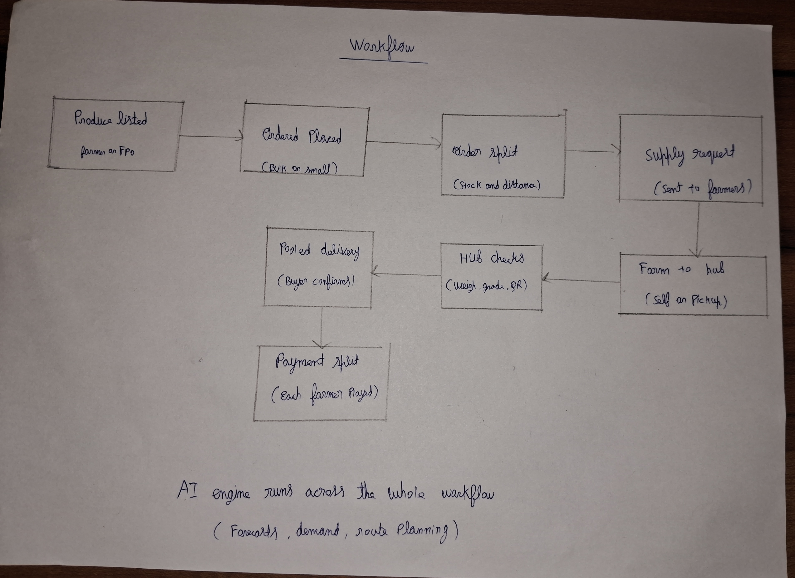
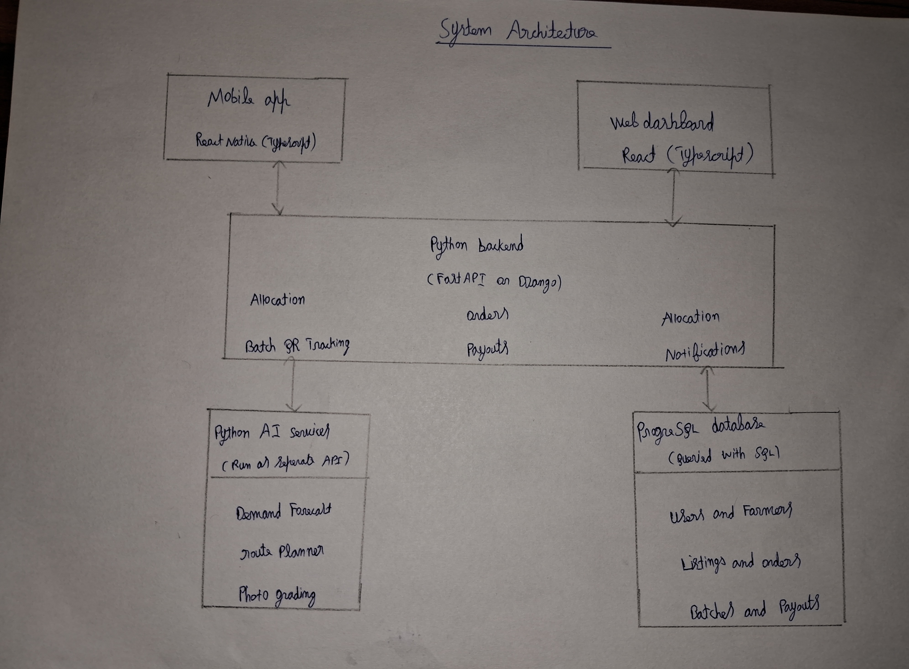

# Smart India Hackathon Workshop
# Date:22.11.2026
## Reference Number:26007392
## Name:Mohamed Aslam N

## Problem Title
SIH 26033: Multiple intermediaries reduce farmers earnings and increase consumer prices.

## Problem Creater's Organization
Ministry of Consumer Affairs, Food & Public Distribution

## Theme
Agriculture, FoodTech & Rural Development

## Problem Description
Expected Solution: Create a digital marketplace that:

• Connects farmers/FPOs directly with consumers and bulk buyers.
• Provides logistics support.
• Uses AI for demand forecasting and route optimization.

Benefits:

• Better prices for farmers.
• Lower prices for consumers.
• Reduced supply chain inefficiencies.

## Proposed Solution
How the solution works:

FARMER TO BUYER DIGITAL MARKETPLACE

Farmers and FPOs can upload information regarding products including amount, quality, date of collection and anticipated cost. Consumers, shops, eateries, hostels and institutions can order items either on small quantities or in bulk and also pre-order. Farmers, or their FPO (which is farmer owned and whilst not obligatory, is positively promoted), can enter details of their produce into a user friendly multi-lingual app. Ideally this should be done weekly. 

BULK ORDERS:

1.Buyer places an order. A restaurant, hostel or retailer says what it needs, such as "300 kg Grade A tomatoes, delivery Friday." Pre-booking days ahead is encouraged. The buyer can pick a specific FPO or farmer or leave the choice to the app.

2.The app splits the order. It picks farmers and FPOs using stock, distance, quality ratings, reliability and fairness, then assigns each a share.

3.Farmers get notified. Each one gets a request with the quantity, grade and hub deadline, and can accept or decline. If someone declines, the app moves to the next farmer.
Produce reaches the hub. Farmers deliver it themselves, or the FPO or a pooled pickup collects it.

4.The hub checks and packs. Staff weigh and grade the produce, give each batch a QR label, and pack the order.
One delivery goes out. A single vehicle takes the whole order to the buyer on an AI-planned route.
Payment is split. The buyer pays once by UPI. The app uses the batch records to pay each farmer for exactly what they supplied, minus the visible hub and platform fees.

SMALL ORDERS:(weekly subscriptions OR on and off)

1.Family orders on the app. They pick items and quantities, such as 2 kg tomatoes, 1 kg onions and 1 kg spinach, and choose a delivery slot. They can order one-off or sign up for a weekly subscription basket, which they can skip, swap or pause before each cut-off.
Order cut-off: Orders close at a set time before delivery day, for example Monday 8 PM for Tuesday delivery. The hub then knows the total demand for the area.

2.The app combines all the small orders a single family's order can contain produce from multiple farmers and the order. this order is considered as a bulk and delivered in one single trip on assigned dates

3.The ai in the app sends request tho the farmers to bring their produce and they bring it on assigned dates

4.the AI plans one route per neighbourhood. Apartment groups get one stop, and families can also collect from a nearby pickup point for a lower fee. Delivery arrives in the chosen slot, 2 or 3 times a week.customers pay through UPI and each individual farmer is paid through the app.

ADDRESSING THE PROBLEM:
removes the need for intermediaries and establishes direct connections between farmers,FPOs and customers. Demand is known in advance through ai model used so farmers are not forced to oblige to any price.Both farmers and customers benefit

INNOVATION AND UNIQUENSESS:

1.Demand first selling

2.transperant prices and cheaper delivery

3.simple to use

4.Ai forecasting

5.Built on existing systems

## Technical Approach
1.Design website and database structures

2.Frontend can be devoloped using javascript or typescript in React Native framework

3.Backend and API can be developed in python using FastAPI or django framework

4.postgreSQL queried in SQL can be used for database.

FARMER TO PAYMENT WORKFLOW

SYSTEM ARCHITECTURE:

## Feasibility and Viability

1.feasibility:The technical components rely on open-source libraries and standard cloud infrastructure, making the system highly scalable and cost-effective.

2.challenges:low digital literacy in rural areas and digital adoption issues.
             perishable goods and spoilage
             data privacy and security
             Ai forecast errors

3.strategy: Start with a small pilot built around farmer-owned FPO hubs and institutional buyers, make the app simple with voice, WhatsApp and offline support, cut costs with pooled routes and AI forecasting, bring existing traders in as partners, and use the pilot data to refine fees, stock buffers and delivery slots before scaling.             

## Impact and Benefits
Impact
farmers:20 to 30% increase in profits due to the absence of middlemen and price transperancy and validation by Ai forecasting.

customers:10 to 20% reduction in prices and steady supply of goods

benefits:
Environmental:reduces food wastage and fuel usage through ai optimised routing

economic: boosts farmer income and provide them oppurtunities and creates a stable system for the produce,delivery of goods boosting economic growth>

## Research and References
1.National Agriculture Market (e-NAM), Government of India: An existing electronic trading platform that connects agricultural markets and promotes transparent price discovery. Website: https://enam.gov.in/.

2.Agmarknet (mandi price data). https://agmarknet.gov.in

3.RBI Working Paper 08/2024, Vegetables Inflation in India: A Study of Tomato, Onion and Potato (TOP). https://rbi.org.in/scripts/PublicationsView.aspx?id=22723

4.Down To Earth, Onions dumped, potato crops destroyed: why falling farm prices are not lowering retail food bills. https://www.downtoearth.org.in/agriculture/onions-dumped-potato-crops-destroyed-why-falling-farm-prices-are-not-lowering-retail-food-bills
